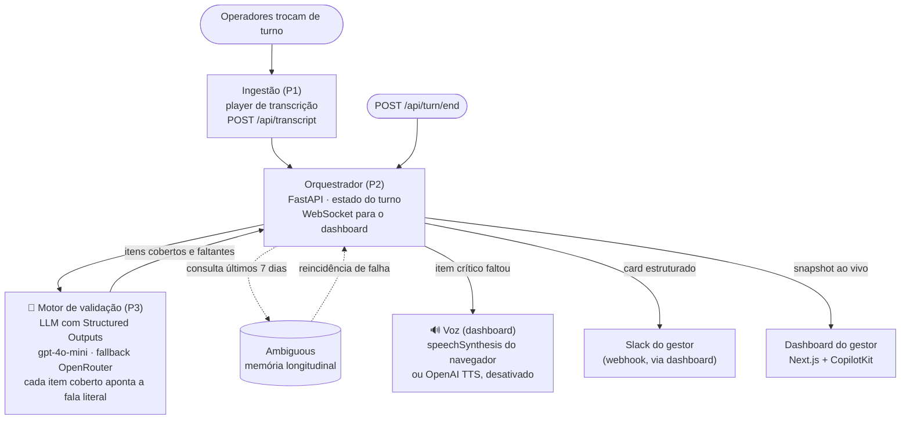

# Relay

Agente de áudio ambiental para passagem de turno: confere se o checklist crítico da estação foi dito em voz alta e, só no fim da conversa, avisa por voz uma única vez se algo ficou faltando.

<!-- DEMO -->

## O problema

Em operação logística, a passagem de turno é verbal, informal e não deixa registro. O que não é dito some, e reaparece horas depois como parada de operação, carga perdida ou acidente. O ambiente é barulhento, a conversa é apressada e nada confere o que ficou de fora.

O Relay não é um chatbot: o operador nunca abre um app nem faz perguntas. O agente escuta a conversa que já acontece, valida contra um checklist e só interrompe uma vez, depois que a conversa termina, e só se faltou algo crítico.

## Como funciona



Pontos de IA no código:

- **LLM (motor de validação):** `backend/validacao.py` e `backend/validation_client.py` comparam a transcrição com o checklist usando Structured Outputs (OpenAI, com contingência via OpenRouter). Cada item marcado como coberto precisa apontar o trecho literal da fala que o prova, porque falso positivo é o pior erro do sistema.
- **Memória longitudinal (Ambiguous):** ao fim do turno, o backend consulta os registros da estação nos últimos 7 dias e sinaliza reincidência (por exemplo, a mesma empilhadeira com falha repetida). Só o registro estruturado é gravado; nenhuma transcrição bruta é enviada. Sem a chave, o fluxo segue com `ambiguous_alert=null`.
- **Voz:** a intervenção é falada no dashboard com `speechSynthesis` do navegador. Existe uma rota para OpenAI TTS (`gpt-4o-mini-tts`), mas ela não está no caminho ativo.
- **Tools/MCP:** o projeto não usa tool calling nem MCP.

## O que é protótipo

Para ser claro sobre o estado do projeto:

- **A fala vem de transcrições, não de microfone.** O "operador falando" é um player (`ingestion/`) que injeta as falas de `mocks/transcricoes/` uma a uma. Não há captura de áudio nem STT no código.
- **CopilotKit** está em estágio de esqueleto; recursos avançados de generative UI não foram explorados.
- **Slack:** o backend monta o card e simula o envio (`backend/slack_mock.py`). O dashboard envia ao webhook real pela rota `/api/slack` quando `SLACK_WEBHOOK_URL` está configurada. Esse envio real não foi verificado nesta revisão do README.
- Estado do turno só em memória, sem autenticação e com CORS aberto.
- Com `gpt-4o-mini`, a transcrição `incompleta_sem_refrigerada` pode não disparar o alerta (o modelo confunde "carga" de bateria com carga refrigerada). Modelos mais fortes ainda não foram testados nas mesmas transcrições.
- Se a validação cair em modo mock (sem crédito ou timeout), o dashboard não mostra isso.
- Não houve validação com usuários reais.

## Stack

- Backend: Python, FastAPI, WebSocket, Pydantic
- LLM: OpenAI (`gpt-4o-mini` por padrão) com Structured Outputs; OpenRouter como contingência
- Dashboard: Next.js 14, React 18, CopilotKit (esqueleto)
- Memória longitudinal: Ambiguous
- Notificação: Slack Incoming Webhook

## Contexto

Projeto feito em cerca de 4 horas no Hackathon Global da AI Tinkerers & OpenAI + partners. Sem colocação.

## Como rodar localmente

Você precisa de 3 terminais, porque o dashboard sozinho fica vazio: quem "fala" é o player de ingestão.

**1. Backend**

```bash
python -m venv .venv && source .venv/bin/activate
pip install -r backend/requirements.txt
cp .env.example .env     # preencha OPENAI_API_KEY; os demais são opcionais
uvicorn backend.main:app --reload --port 8000
```

**2. Dashboard**

```bash
cd dashboard
npm install
cp .env.local.example .env.local   # deixe a chave de TTS vazia para usar a voz do navegador
npm run dev
```

**3. Player de ingestão**

```bash
pip install -r ingestion/requirements.txt
python -m ingestion.cli --file mocks/transcricoes/completa_padrao.txt --auto
```

Transcrições de exemplo em `mocks/transcricoes/`: `completa_padrao.txt` (tudo coberto), `empilhadeira2_problema.txt` (com reincidência de falha) e `incompleta_sem_refrigerada.txt` (item crítico faltando).

**Testes**

```bash
pip install pytest
python -m pytest backend -q
```

Os testes do backend rodam sem chaves de API. A especificação completa do projeto está em `01-requisitos.md` a `05-arquitetura.md`.
